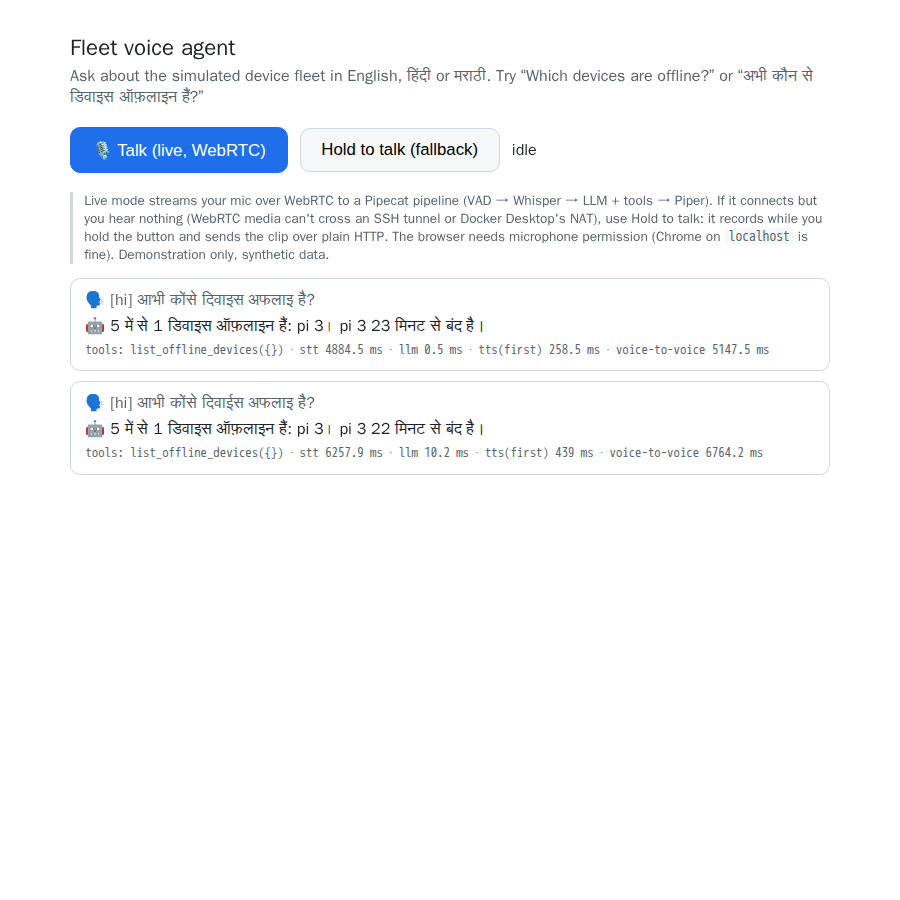
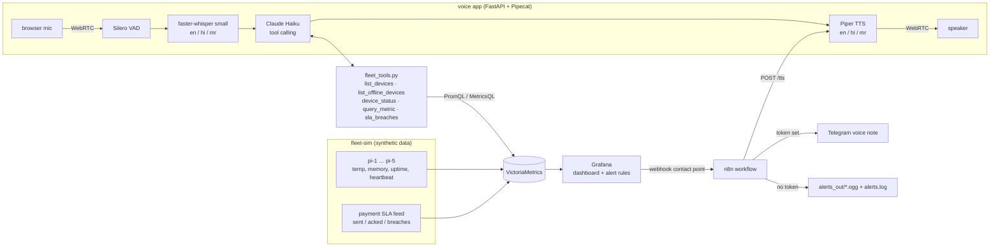

# fleet-voice-agent

**Talk to your device fleet in English, Hindi or Marathi.** This is a voice agent with tool calling over a
VictoriaMetrics/Grafana stack. It also sends voice alerts through n8n.

You ask "Which devices are offline?" or "पाई 3 का तापमान क्या है?" or "गेल्या 10 मिनिटांत किती पेमेंट एसएलए उल्लंघने झाली?"
in a browser. The app transcribes the speech, has Claude call PromQL tools against VictoriaMetrics, and speaks a short
answer back in the same language. When a device goes silent, Grafana fires an alert, n8n turns it into a sentence, the
app speaks it, and the result arrives as a Telegram voice note (or as an `.ogg` in `alerts_out/` if Telegram isn't
configured).

> **Demonstration only.** The 5 devices (`pi-1` … `pi-5`) and the payment-SLA feed are **simulated**, and all eval audio
> is **synthetic speech**. This is a "device fleet", not a clinical or safety system, and it has no authentication.



## Architecture



## Container runtime

Runs with **Docker** (Docker Desktop on Windows/macOS, Docker Engine on Linux) using `docker compose up -d`.
The Compose file sticks to the standard Compose spec, so other Compose-compatible tools (Podman, OrbStack,
Rancher Desktop, Colima) can run it too. Should work with Podman (standard Compose spec) but is not tested yet.
Why Docker and not the others: [docs/adr/0001-container-runtime.md](docs/adr/0001-container-runtime.md).

## Results

Measured on a shared 2 vCPU VPS, CPU only, with STT on 1 thread. Full tables, commands and caveats are in **[RESULTS.md](RESULTS.md)**.

| | |
|---|---|
| p50 voice-to-voice latency (30 questions, in-process) | **8.02 s** (p95 9.72 s) |
| p50 voice-to-voice over WebRTC (client-measured, 9 clips) | **8.78 s** |
| Tool-choice accuracy, voice → Whisper → Claude (30 questions) | **96.7 %** (100 % on clean text) |
| Hindi STT word error rate (10 clips) | **0.338** (CER 0.117) |
| Answer contains the key fact (30 questions) | 96.7 % |
| `make chaos` → voice note saved | **138 s** (threshold is 120 s of silence) |
| No API key (Docker default, rules router): p50 voice-to-voice / tool choice | 5.1 s / 90 % (optimistic, see RESULTS) |

**Eval round 2** (noise, Marathi STT, language ID; details in [RESULTS.md](RESULTS.md#eval-round-2-2026-11-23-noise-sweep-marathi-stt-comparison-language-id)):

| | |
|---|---|
| Tool choice with noise at 10 dB SNR (Whisper-small → Claude, 30 clips) | 87 % white / 90 % babble+fan (clean 97 %) |
| Marathi WER: Whisper-medium vs small (10 clips, 1 CPU thread) | 0.508 vs 0.603, but 12.7 s vs 4.4 s per clip, so the default stays **small** |
| Language ID en/hi/mr, clean (30 clips) | 93.3 %; every miss is Marathi → Hindi |

Where the 8 s goes: STT about 4.0 s (one Whisper encoder pass on one CPU thread), LLM about 3.6 s (two `claude -p` calls,
since the build host has no API key), TTS first sentence about 0.23 s.

Demo media (all generated by scripted runs, with no human microphone):
- Spoken replies: `examples/offline/*.reply.wav` (in-process) and `examples/webrtc/*.reply.wav` (over WebRTC), each
  next to a JSON file with the transcript, tool calls, answer and timings.
- Alert voice note: `examples/alerts/pi-2_offline_alert.ogg` ("Alert: pi 2 has been offline for 2 minutes.")
- Dashboard: `examples/grafana_dashboard.png`. Browser check: `examples/browser/`.

## Stack

| Part | What |
|---|---|
| Voice pipeline | **Pipecat 1.17** with `SmallWebRTCTransport` (browser WebRTC, no LiveKit/Daily account) and `VADProcessor(SileroVADAnalyzer)` |
| Speech-to-text | **faster-whisper `small`** (multilingual, CPU int8), restricted to en/hi/mr |
| LLM | **Claude Haiku** (`claude-haiku-5-5`) with tool calling. Backends: Anthropic API (native tool use), `claude -p` CLI (2-step JSON tool protocol), or an offline rules router when neither is available |
| Text-to-speech | **Piper**: `en_US-lessac`, `hi_IN-pratham`, `mr_IN-google` (a real offline Marathi voice) |
| Metrics | VictoriaMetrics v1.155, Grafana 13.3 (provisioned datasource, dashboard and 2 alert rules) |
| Automation | n8n 1.123: Grafana webhook → sentence → `/tts` → Telegram `sendVoice` or `alerts_out/` |
| Tests | pytest: a fake VictoriaMetrics HTTP server, a mocked LLM, the n8n Code node run under Node.js, and live tests against Docker |

## How it works

**One voice turn** (`voice/engine.py`, shared by the WebRTC pipeline, push-to-talk, the scripted runs and the eval):
1. **VAD** (Silero, 0.6 s of silence ends the turn) cuts out the utterance. A 0.5 s pre-roll keeps the first syllable.
2. **STT**: Whisper's language probabilities are restricted to en/hi/mr. Whisper-small hardly ever prefers Marathi, so
   Indic speech is decoded with the Marathi token plus a short domain prompt, and a word-list check
   (`agent/lang.py`) decides Hindi vs Marathi from the transcript. This policy was tuned on a separate dev set
   (`evals/tune_stt.py`). The detection pass's encoder output is reused for transcription, which saves one
   30-second encoder pass per turn.
3. **Agent** (`agent/agent.py`): Claude gets the transcript plus "the user spoke Hindi, reply in Hindi". It calls the
   tools in `agent/fleet_tools.py` and answers in at most 2 short spoken sentences, with numbers rounded and kept as
   digits.
4. **TTS**: Piper speaks the answer one sentence at a time in the reply language. Its espeak-ng front end reads digits
   natively ("55" → "पचपन" / "पंचावन्न").

**Tools** query VictoriaMetrics with PromQL/MetricsQL. "Offline" means `device_uptime_seconds` is more than 120 s old,
the same rule the dashboard and the Grafana alert use. The rule is adapted from icu-observability-stack's contract.

**Alerts**: Grafana rule `DeviceSilent` (silent > 2 min) and `PaymentSLABreaches` (> 0 in 5 min) → webhook →
`n8n/workflows/voice_alert.json` → `POST /tts` (Ogg/Opus via PyAV) → Telegram `sendVoice` if `TELEGRAM_BOT_TOKEN` and
`TELEGRAM_CHAT_ID` are set, else save to `alerts_out/` and append to `alerts_out/alerts.log`. `ALERT_LANG=hi|mr` speaks
alerts in Hindi or Marathi.

## Quick start

```bash
cp .env.example .env              # optional: ANTHROPIC_API_KEY, TELEGRAM_* (everything works without them)
docker compose up -d --build      # first start downloads ~780 MB of speech models into ./models
# Grafana  http://localhost:13000  (admin / admin)
# Voice    http://localhost:17860  (click Talk, or hold "Hold to talk")
make chaos DEVICE=pi-2            # wait ~2.5 min, then look in alerts_out/
make test                         # unit tests, no Docker or models needed
make eval                         # the voice eval (needs the venv + models, see TESTING.md)
```

[TESTING.md](TESTING.md) has step-by-step instructions for a Windows laptop.

## Design decisions

- **No API key on the build host**, so the eval used Claude through the `claude -p` CLI with a 2-step JSON protocol: plan
  the tool calls, run them, then answer. With `ANTHROPIC_API_KEY` set, the app uses native tool use instead
  (`AnthropicBackend`, unit-tested with a fake client but not measured). Without either, the Docker app falls back to a
  keyword router, so the demo still works. Its accuracy is reported separately and is lower.
- **Half-duplex turns.** Speech that starts while the bot is thinking is ignored. Barge-in is future work.
- **Push-to-talk fallback.** WebRTC media can't cross an SSH tunnel or some Docker Desktop NAT setups, so the page also
  has an HTTP "Hold to talk" button that runs the same engine.
- **Ports are high and bound to 127.0.0.1** (13000, 17860, 15678, 18428), because the build host is shared. Change them in `.env`.
- **Memory budget**: every container has a `mem_limit`, about 2.85 GB in total. The voice app used about 0.6 GB with all models loaded.

## Sources and licences

- Code: MIT ([LICENSE](LICENSE)).
- Reused ideas, metric names and alert/dashboard queries come from the author's
  `icu-observability-stack` (device metric contract, offline rule, DeviceOffline alert) and `swift-mt103-monitor`
  (`swift.sla.breaches`, `swift.queue.depth`, … as `swift_*` Prometheus names). Both are by the same author and were
  adapted here as a generic "device fleet". This project keeps their demonstration-only spirit.
- Models (downloaded, not committed): faster-whisper `small` (MIT, OpenAI Whisper weights). Piper voices from
  `rhasspy/piper-voices`, each under its own dataset licence (see each voice's `MODEL_CARD`): `hi_IN-pratham` is
  **CC BY-NC-SA 4.0 (non-commercial)**, `mr_IN-google` is CC BY-SA 4.0 (OpenSLR 64), `hi_IN-rohan` uses the IIT Madras
  IndicTTS licence, `en_US-lessac` uses the Blizzard 2013 licence (research use) and `en_US-amy` comes from Mycroft
  mimic3-voices. **Check these before any commercial use.**

## What I'd do next

- **Phone calls**: put the same pipeline behind a SIP provider or Twilio Media Streams (Pipecat has transports for
  both), so an on-call engineer can ring the fleet and alerts can call instead of sending a voice note.
- **Wake word** ("Hey fleet") with openWakeWord, so the mic can stay open without sending everything to STT.
- **On-device STT on the Pi**: whisper.cpp `base`/`small` int8 on a Pi 5, sending only text upstream (lower bandwidth,
  better privacy).
- **Cut latency**: use the native API with streaming (no CLI start-up, start TTS on the first streamed sentence),
  use more STT threads or a GPU, and try an Indic-tuned ASR model (e.g. AI4Bharat IndicConformer) for Marathi,
  where Whisper-small has 0.60 WER (Whisper-medium gets 0.51, but is 3× slower on one thread; see RESULTS round 2).
- **Noise robustness**: Marathi tool choice drops to 60–70 % at 10 dB SNR. Next would be a denoiser in front of
  Whisper (e.g. RNNoise) and real noisy recordings.
- **Barge-in**: stop TTS when the user starts speaking (Pipecat interruptions).
- **Normalise device names** in answers ("पi 3" → "pi 3") before TTS. This was the one wrong answer on clean text.

## Resume line

> Multilingual (en/hi/mr) voice agent over an observability stack: Pipecat + faster-whisper + tool-calling LLM,
> p50 voice-to-voice 8.0 s on a 2-vCPU CPU-only box, tool accuracy 96.7 %; Grafana → n8n → Telegram voice alerts.
