# E2E run report

Generated from the run's own output by `e2e/scripts/make-report.mjs`; nothing here is typed by hand.
Use it to check what the suite did **without re-running it**: every voice turn shows what the app heard, what it
answered and which tool it called, with a screenshot of what the user saw.

| | |
|---|---|
| Result | **16 passed**, **2 expected failures** (known defects), **0 failed**, 0 flaky, 0 skipped |
| Suite time | 9.1 min (started 2026-11-27T15:21:35.441Z) |
| Code under test | `da4d750aa707` on `e2e-playwright` |
| Where | local run (not CI) |
| Machine | 2 CPU, 8 GB RAM, linux 5.15.0-198-generic |
| Backend | `rules` (offline rules router = no API key), Playwright 1.65.1, Node v26.13.1 |
| Fleet setup | pi-3 forced offline and silent > 130 s after 135 s of setup; pi-1, 2, 4, 5 online; random flapping off |

"Expected failure" means the test exposed a defect that is written up in [DEFECTS.md](../DEFECTS.md) and is marked
`test.fail()`; it turns into a real failure the day the defect is fixed.

## All tests

| # | File | Test | Result | Time | |
|---|---|---|---|---|---|
| 1 | 01-voice.spec.ts | live voice (WebRTC): which devices are offline? › en01 [en] "Which devices are offline right now?" | passed | 13.9 s | [details](#t01) |
| 2 | 01-voice.spec.ts | live voice (WebRTC): which devices are offline? › hi01 [hi] "अभी कौन से डिवाइस ऑफ़लाइन हैं?" | passed | 13.0 s | [details](#t02) |
| 3 | 01-voice.spec.ts | live voice (WebRTC): which devices are offline? › mr01 [mr] "सध्या कोणती उपकरणे ऑफलाइन आहेत?" | passed | 14.4 s | [details](#t03) |
| 4 | 01-voice.spec.ts | live voice (WebRTC): device-specific questions › en07 [en] temperature of pi 2: names the device and gives a number in degrees | passed | 12.3 s | [details](#t04) |
| 5 | 01-voice.spec.ts | live voice (WebRTC): device-specific questions › hi05 [hi] status of pi 3: reply says it is offline, in hi | passed | 13.4 s | [details](#t05) |
| 6 | 01-voice.spec.ts | live voice (WebRTC): device-specific questions › mr05 [mr] status of pi 3: reply says it is offline, in mr | passed | 12.9 s | [details](#t06) |
| 7 | 01-voice.spec.ts | push-to-talk fallback (HTTP) en01: same answer path without WebRTC | passed | 15.2 s | [details](#t07) |
| 8 | 02-edge.spec.ts | silence › live mode with a silent mic: stays ready, invents no turn, can be stopped | passed | 15.7 s | [details](#t08) |
| 9 | 02-edge.spec.ts | silence › push-to-talk with a silent mic: the user is told nothing was heard | expected failure [DEF-002](../DEFECTS.md#def-002) | 10.5 s | [details](#t09) |
| 10 | 02-edge.spec.ts | noisy clip (en01 + pink noise, babble and hum at 10 dB SNR): still names the offline device | passed | 12.5 s | [details](#t10) |
| 11 | 02-edge.spec.ts | questions no tool can answer › en_oos_weather [en] "What will the weather be like in Mumbai tomorrow?": says what it can answer, calls no tool, same language | passed | 12.3 s | [details](#t11) |
| 12 | 02-edge.spec.ts | questions no tool can answer › hi_oos_cricket [hi] "कल क्रिकेट मैच का स्कोर क्या था?": says what it can answer, calls no tool, same language | passed | 12.8 s | [details](#t12) |
| 13 | 02-edge.spec.ts | backend down › live mode when the backend is down: a visible error and the button resets | expected failure [DEF-003](../DEFECTS.md#def-003) | 35.4 s | [details](#t13) |
| 14 | 02-edge.spec.ts | backend down › push-to-talk when the backend is down: a visible error, not a stuck 'thinking…' | passed | 25.6 s | [details](#t14) |
| 15 | 02-edge.spec.ts | backend down › backend dies in the middle of a live turn: the user is told, the page does not hang | passed | 28.9 s | [details](#t15) |
| 16 | 03-observability.spec.ts | make chaos pi-4 → Grafana › DeviceSilent fires after the 120 s threshold and within the rule's window | passed | 132.0 s | [details](#t16) |
| 17 | 03-observability.spec.ts | make chaos pi-4 → Grafana › the dashboard shows the device OFFLINE | passed | 7.2 s | [details](#t17) |
| 18 | 03-observability.spec.ts | make chaos pi-4 → Grafana › the alerting UI lists DeviceSilent as Firing | passed | 6.0 s | [details](#t18) |

## Details

### <a id="t01"></a>1. live voice (WebRTC): which devices are offline? › en01 [en] "Which devices are offline right now?"

**passed** · 13.9 s · `01-voice.spec.ts`

| | |
|---|---|
| Heard (transcript) | Which devices are offline right now? |
| Language detected | `en` |
| Reply | 1 of 5 devices are offline: pi 3. pi 3 has been silent for 2 minutes. |
| Tool calls | `list_offline_devices` |
| Timings | stt 4974 ms · llm 9.3 ms · tts(first) 348.4 ms · voice-to-voice 5366.8 ms |

| | |
|---|---|
| Heard (transcript) | Which devices are offline right now? |
| Language detected | `en` |
| Reply | 1 of 5 devices are offline: pi 3. pi 3 has been silent for 2 minutes. |
| Tool calls | `list_offline_devices` |
| Timings | stt 4974 ms · llm 9.3 ms · tts(first) 348.4 ms · voice-to-voice 5366.8 ms |

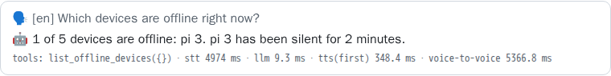


### <a id="t02"></a>2. live voice (WebRTC): which devices are offline? › hi01 [hi] "अभी कौन से डिवाइस ऑफ़लाइन हैं?"

**passed** · 13.0 s · `01-voice.spec.ts`

| | |
|---|---|
| Heard (transcript) | आभी कोंछे दिवाईस अफलाइन है? |
| Language detected | `hi` |
| Reply | 5 में से 1 डिवाइस ऑफ़लाइन हैं: pi 3। pi 3 3 मिनट से बंद है। |
| Tool calls | `list_offline_devices` |
| Timings | stt 5052.4 ms · llm 0.7 ms · tts(first) 443.8 ms · voice-to-voice 5502.1 ms |

| | |
|---|---|
| Heard (transcript) | आभी कोंछे दिवाईस अफलाइन है? |
| Language detected | `hi` |
| Reply | 5 में से 1 डिवाइस ऑफ़लाइन हैं: pi 3। pi 3 3 मिनट से बंद है। |
| Tool calls | `list_offline_devices` |
| Timings | stt 5052.4 ms · llm 0.7 ms · tts(first) 443.8 ms · voice-to-voice 5502.1 ms |

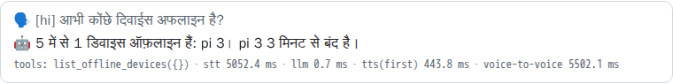


### <a id="t03"></a>3. live voice (WebRTC): which devices are offline? › mr01 [mr] "सध्या कोणती उपकरणे ऑफलाइन आहेत?"

**passed** · 14.4 s · `01-voice.spec.ts`

| | |
|---|---|
| Heard (transcript) | सद्धा कोंती उपकरने अप्लाइ आहेत. |
| Language detected | `mr` |
| Reply | 5 पैकी 4 उपकरणे ऑनलाइन आहेत, आणि pi 3 ऑफलाइन आहे. |
| Tool calls | `list_devices` |
| Timings | stt 5844.3 ms · llm 1.1 ms · tts(first) 680.4 ms · voice-to-voice 6546.4 ms |

| | |
|---|---|
| Heard (transcript) | सद्धा कोंती उपकरने अप्लाइ आहेत. |
| Language detected | `mr` |
| Reply | 5 पैकी 4 उपकरणे ऑनलाइन आहेत, आणि pi 3 ऑफलाइन आहे. |
| Tool calls | `list_devices` |
| Timings | stt 5844.3 ms · llm 1.1 ms · tts(first) 680.4 ms · voice-to-voice 6546.4 ms |

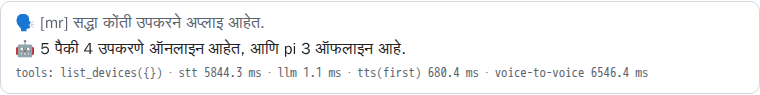


### <a id="t04"></a>4. live voice (WebRTC): device-specific questions › en07 [en] temperature of pi 2: names the device and gives a number in degrees

**passed** · 12.3 s · `01-voice.spec.ts`

| | |
|---|---|
| Heard (transcript) | What is the temperature of pi 2? |
| Language detected | `en` |
| Reply | pi 2 temperature is 44 degrees now, averaging 49 degrees over the last 10 minutes. |
| Tool calls | `query_metric` |
| Timings | stt 4195.7 ms · llm 0.2 ms · tts(first) 716.7 ms · voice-to-voice 4937.2 ms |

| | |
|---|---|
| Heard (transcript) | What is the temperature of pi 2? |
| Language detected | `en` |
| Reply | pi 2 temperature is 44 degrees now, averaging 49 degrees over the last 10 minutes. |
| Tool calls | `query_metric` |
| Timings | stt 4195.7 ms · llm 0.2 ms · tts(first) 716.7 ms · voice-to-voice 4937.2 ms |

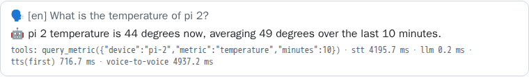


### <a id="t05"></a>5. live voice (WebRTC): device-specific questions › hi05 [hi] status of pi 3: reply says it is offline, in hi

**passed** · 13.4 s · `01-voice.spec.ts`

| | |
|---|---|
| Heard (transcript) | पाई 3 किस्थे तिक्या है? |
| Language detected | `hi` |
| Reply | pi 3 ऑफ़लाइन है, यह 3 मिनट से चुप है। |
| Tool calls | `device_status` |
| Timings | stt 6058 ms · llm 0.3 ms · tts(first) 498.6 ms · voice-to-voice 6573.2 ms |

| | |
|---|---|
| Heard (transcript) | पाई 3 किस्थे तिक्या है? |
| Language detected | `hi` |
| Reply | pi 3 ऑफ़लाइन है, यह 3 मिनट से चुप है। |
| Tool calls | `device_status` |
| Timings | stt 6058 ms · llm 0.3 ms · tts(first) 498.6 ms · voice-to-voice 6573.2 ms |

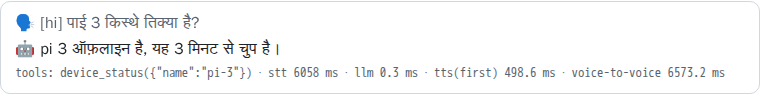


### <a id="t06"></a>6. live voice (WebRTC): device-specific questions › mr05 [mr] status of pi 3: reply says it is offline, in mr

**passed** · 12.9 s · `01-voice.spec.ts`

| | |
|---|---|
| Heard (transcript) | पाई 3 चिस्टिटिका आहे. |
| Language detected | `mr` |
| Reply | pi 3 ऑफलाइन आहे, ते 4 मिनिटांपासून बंद आहे. |
| Tool calls | `device_status` |
| Timings | stt 5187.4 ms · llm 0.3 ms · tts(first) 693.2 ms · voice-to-voice 5899.7 ms |

| | |
|---|---|
| Heard (transcript) | पाई 3 चिस्टिटिका आहे. |
| Language detected | `mr` |
| Reply | pi 3 ऑफलाइन आहे, ते 4 मिनिटांपासून बंद आहे. |
| Tool calls | `device_status` |
| Timings | stt 5187.4 ms · llm 0.3 ms · tts(first) 693.2 ms · voice-to-voice 5899.7 ms |

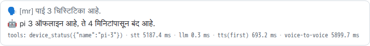


### <a id="t07"></a>7. push-to-talk fallback (HTTP) en01: same answer path without WebRTC

**passed** · 15.2 s · `01-voice.spec.ts`

| | |
|---|---|
| Heard (transcript) | Which devices are offline right now? |
| Language detected | `en` |
| Reply | 1 of 5 devices are offline: pi 3. pi 3 has been silent for 4 minutes. |
| Tool calls | `list_offline_devices` |
| Timings | stt 3387 ms · llm 0.1 ms · tts(first) 288.9 ms · voice-to-voice 3680.3 ms |

| | |
|---|---|
| Heard (transcript) | Which devices are offline right now? |
| Language detected | `en` |
| Reply | 1 of 5 devices are offline: pi 3. pi 3 has been silent for 4 minutes. |
| Tool calls | `list_offline_devices` |
| Timings | stt 3387 ms · llm 0.1 ms · tts(first) 288.9 ms · voice-to-voice 3680.3 ms |

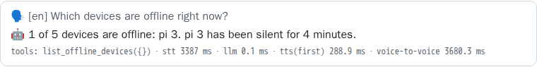


### <a id="t08"></a>8. silence › live mode with a silent mic: stays ready, invents no turn, can be stopped

**passed** · 15.7 s · `02-edge.spec.ts`


### <a id="t09"></a>9. silence › push-to-talk with a silent mic: the user is told nothing was heard

**expected failure** [DEF-002](../DEFECTS.md#def-002) · 10.5 s · `02-edge.spec.ts`

```text
Error: expect(received).toMatch(expected)
Expected pattern: /nothing heard|no speech|error/i
Received string:  "🗣️ [mr] अपने �
🤖 मी फक्त उपकरणांच्या ताफ्याबद्दल आणि पेमेंट गेटवेबद्दल सांगू शकतो.
tools: none · stt 5874.8 ms · llm 0.8 ms · tts(first) 588.8 ms · voice-to-voice 6464.5 ms"
```

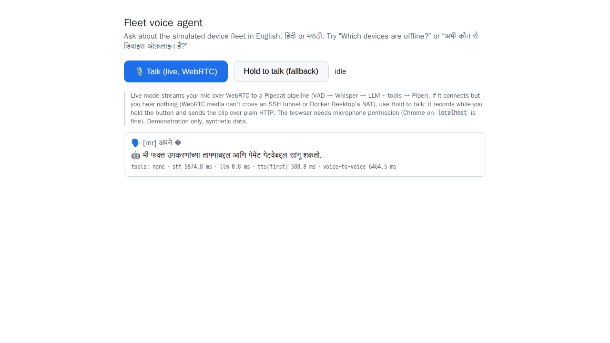


### <a id="t10"></a>10. noisy clip (en01 + pink noise, babble and hum at 10 dB SNR): still names the offline device

**passed** · 12.5 s · `02-edge.spec.ts`

| | |
|---|---|
| Heard (transcript) | Which devices are offline right now? |
| Language detected | `en` |
| Reply | 1 of 5 devices are offline: pi 3. pi 3 has been silent for 4 minutes. |
| Tool calls | `list_offline_devices` |
| Timings | stt 4215.3 ms · llm 0.1 ms · tts(first) 390.4 ms · voice-to-voice 4611.2 ms |

| | |
|---|---|
| Heard (transcript) | Which devices are offline right now? |
| Language detected | `en` |
| Reply | 1 of 5 devices are offline: pi 3. pi 3 has been silent for 4 minutes. |
| Tool calls | `list_offline_devices` |
| Timings | stt 4215.3 ms · llm 0.1 ms · tts(first) 390.4 ms · voice-to-voice 4611.2 ms |

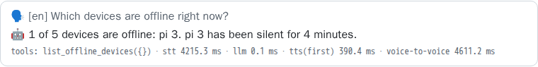


### <a id="t11"></a>11. questions no tool can answer › en_oos_weather [en] "What will the weather be like in Mumbai tomorrow?": says what it can answer, calls no tool, same language

**passed** · 12.3 s · `02-edge.spec.ts`

| | |
|---|---|
| Heard (transcript) | What will the weather be like in Mumbai tomorrow? |
| Language detected | `en` |
| Reply | I can only answer questions about the device fleet and the payment gateway. |
| Tool calls | none |
| Timings | stt 4449.4 ms · llm 0.1 ms · tts(first) 512.3 ms · voice-to-voice 4961.8 ms |

| | |
|---|---|
| Heard (transcript) | What will the weather be like in Mumbai tomorrow? |
| Language detected | `en` |
| Reply | I can only answer questions about the device fleet and the payment gateway. |
| Tool calls | none |
| Timings | stt 4449.4 ms · llm 0.1 ms · tts(first) 512.3 ms · voice-to-voice 4961.8 ms |


### <a id="t12"></a>12. questions no tool can answer › hi_oos_cricket [hi] "कल क्रिकेट मैच का स्कोर क्या था?": says what it can answer, calls no tool, same language

**passed** · 12.8 s · `02-edge.spec.ts`

| | |
|---|---|
| Heard (transcript) | कल ग्रिकेट मेजका स्कोर क्या था? |
| Language detected | `hi` |
| Reply | मैं सिर्फ़ डिवाइस फ़्लीट और पेमेंट गेटवे के बारे में बता सकता हूँ। |
| Tool calls | none |
| Timings | stt 5313.9 ms · llm 0.9 ms · tts(first) 575.1 ms · voice-to-voice 5889.9 ms |

| | |
|---|---|
| Heard (transcript) | कल ग्रिकेट मेजका स्कोर क्या था? |
| Language detected | `hi` |
| Reply | मैं सिर्फ़ डिवाइस फ़्लीट और पेमेंट गेटवे के बारे में बता सकता हूँ। |
| Tool calls | none |
| Timings | stt 5313.9 ms · llm 0.9 ms · tts(first) 575.1 ms · voice-to-voice 5889.9 ms |


### <a id="t13"></a>13. backend down › live mode when the backend is down: a visible error and the button resets

**expected failure** [DEF-003](../DEFECTS.md#def-003) · 35.4 s · `02-edge.spec.ts`

```text
Error: expect(locator).toHaveText(expected) failed
Locator: getByTestId('status')
Expected pattern: /error|failed/i
Received string:  "idle"
Timeout: 20000ms
Call log:
```

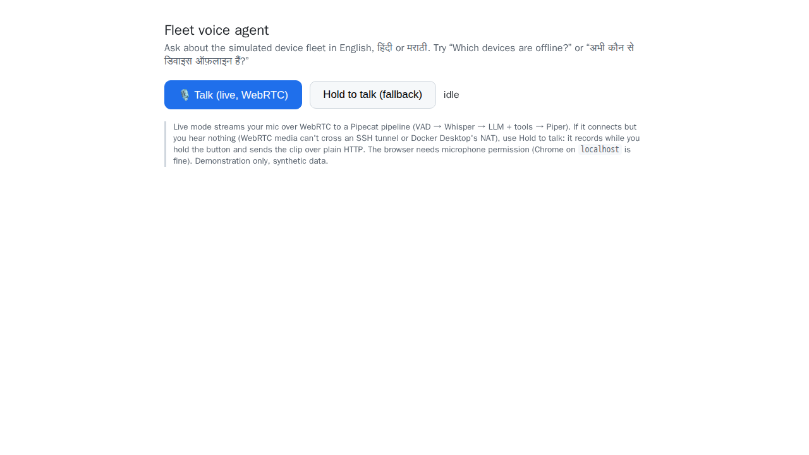


### <a id="t14"></a>14. backend down › push-to-talk when the backend is down: a visible error, not a stuck 'thinking…'

**passed** · 25.6 s · `02-edge.spec.ts`


### <a id="t15"></a>15. backend down › backend dies in the middle of a live turn: the user is told, the page does not hang

**passed** · 28.9 s · `02-edge.spec.ts`


### <a id="t16"></a>16. make chaos pi-4 → Grafana › DeviceSilent fires after the 120 s threshold and within the rule's window

**passed** · 132.0 s · `03-observability.spec.ts`

- measured: DeviceSilent fired 132 s after make chaos
- measured: DeviceSilent fired 132 s after make chaos


### <a id="t17"></a>17. make chaos pi-4 → Grafana › the dashboard shows the device OFFLINE

**passed** · 7.2 s · `03-observability.spec.ts`

- grafana-memory: 268 / 320 MiB (DEF-001 if this test fails)
- grafana-memory: 268 / 320 MiB (DEF-001 if this test fails)

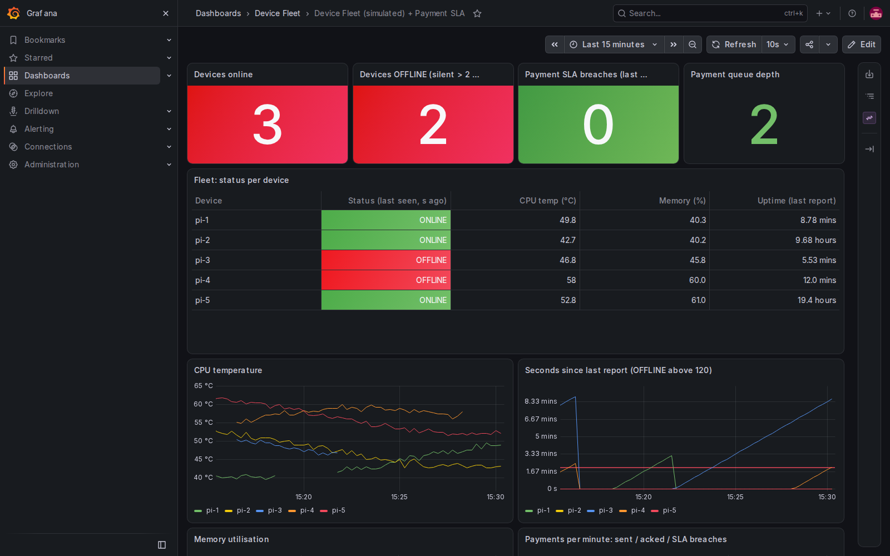


### <a id="t18"></a>18. make chaos pi-4 → Grafana › the alerting UI lists DeviceSilent as Firing

**passed** · 6.0 s · `03-observability.spec.ts`

- grafana-memory: 292 / 320 MiB (DEF-001 if this test fails)
- grafana-memory: 292 / 320 MiB (DEF-001 if this test fails)

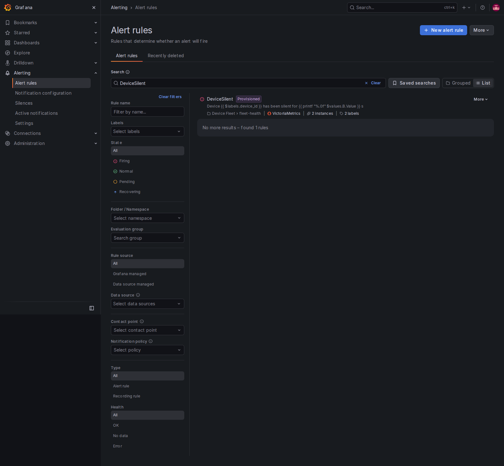

